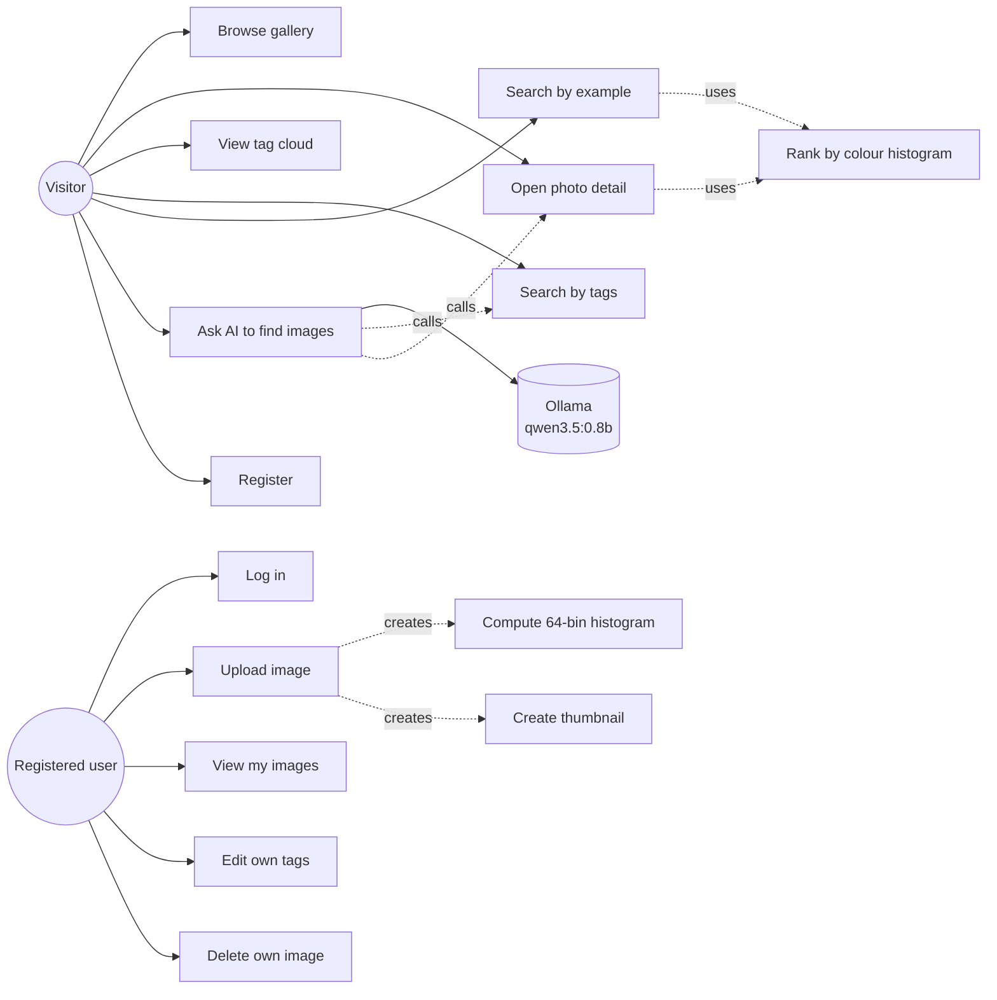
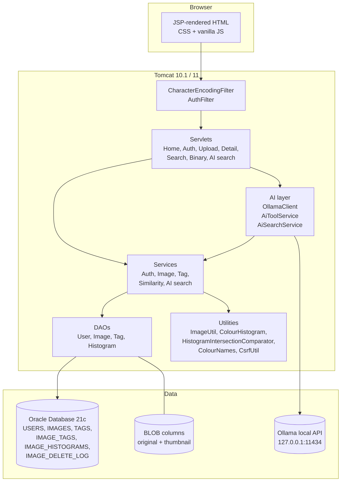
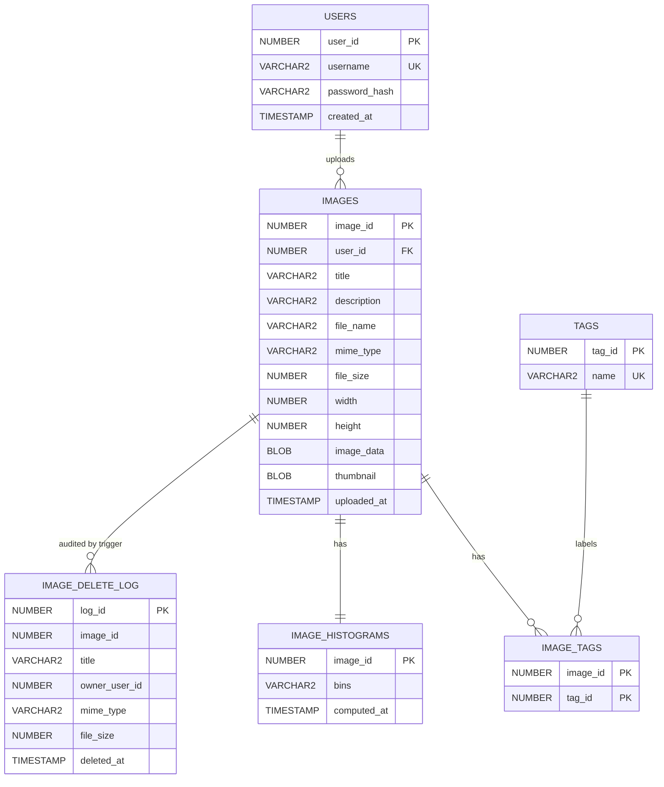
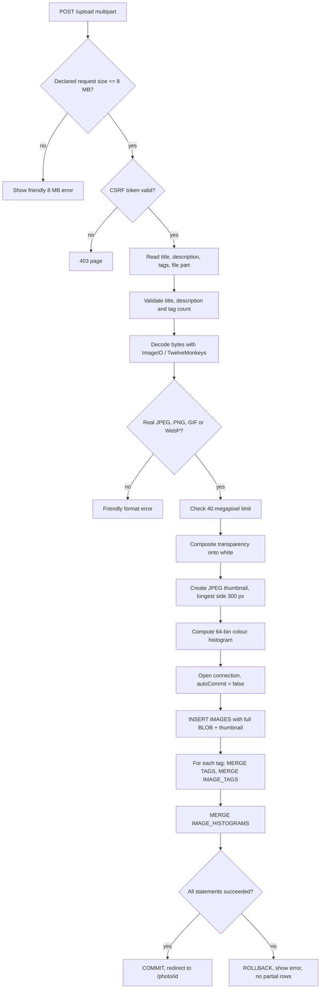
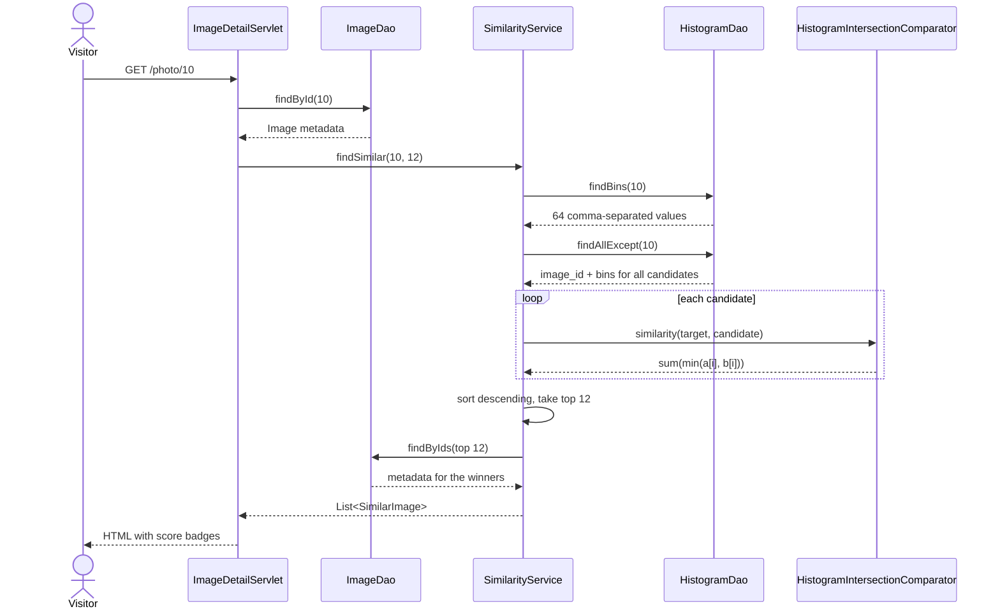
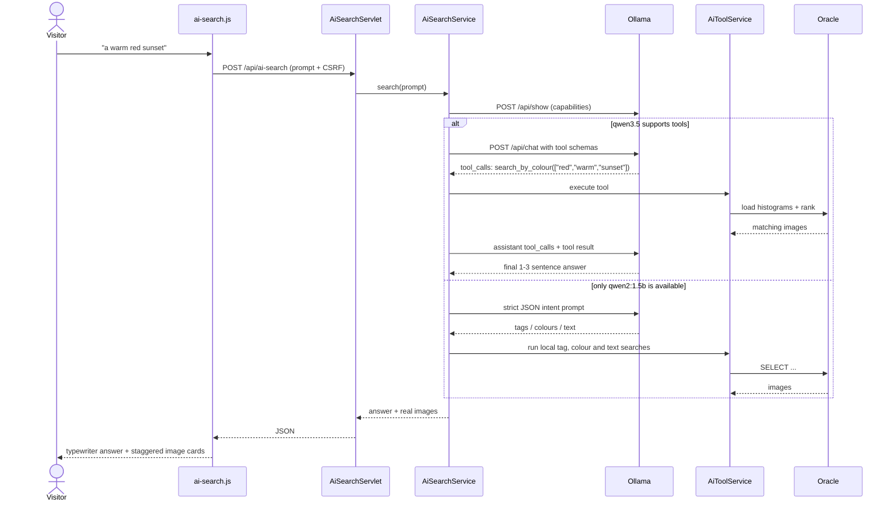
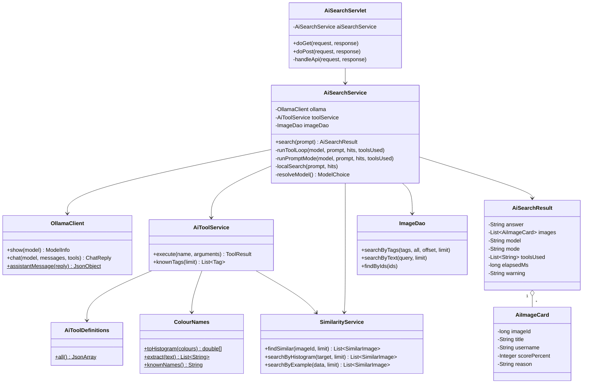

# HueGallery — Design and UML Diagrams

This document covers the design artefacts requested in the project proposal:
use case, architecture, ERD, activity, sequence and class diagrams, plus the
design of the optional local-AI search. The diagrams are Mermaid and render
directly on GitHub, VS Code (with a Markdown preview extension) and most
Markdown viewers.

---

## 1. Scope and actors

| Actor | Capabilities |
| --- | --- |
| Visitor | Browse the gallery, open a photo, use the tag cloud, search by tag, search by example, ask the AI assistant. |
| Registered user | Everything a visitor can do, plus upload, edit tags on their own images, delete their own images, and view **My images**. |
| Ollama (external, local) | Parses a natural-language prompt and optionally calls gallery tools. |

---

## 2. Use case diagram

---

## 3. System architecture

The application is a classic three-tier server-rendered web app. The AI layer
is an optional fourth collaborator: it calls the same services/DAOs as the HTML
controllers, so the model never touches SQL directly.

---

## 4. Entity–relationship diagram

`IMAGE_TAGS` is the many-to-many join table. `IMAGE_HISTOGRAMS` has a
one-to-one primary-key/foreign-key relationship with `IMAGES`. Foreign keys use
`ON DELETE CASCADE` for tag links and histograms; orphan `TAGS` rows are removed
by the application (or by the optional `PRUNE_ORPHAN_TAGS` procedure).

---

## 5. Upload activity diagram

---

## 6. Similarity sequence diagram

---

## 7. AI search sequence diagram

If Ollama is offline, `AiSearchService` catches the connection error and runs a
deterministic keyword/colour search so the page still returns something useful.
The UI shows a warning explaining the degraded mode.

---

## 8. Class diagram

---

## 9. AI tool contract

| Tool | Arguments | What it does |
| --- | --- | --- |
| `list_tags` | none | Returns the most-used tags and their image counts. |
| `search_by_tags` | `tags[]`, `match` (`any`/`all`), `limit` | Runs the existing tag SQL. Falls back from ALL → ANY → split words when a strict query is empty. |
| `search_by_text` | `query`, `limit` | `LOWER(title) LIKE ?` or `LOWER(description) LIKE ?`, with `%`/`_` escaped. |
| `search_by_colour` | `colours[]`, `limit` | Maps colour words (`red`, `warm`, `sunset`, `ocean`, `#rrggbb`) to a target 64-bin histogram and ranks the gallery with histogram intersection. |
| `find_similar` | `image_id`, `limit` | Reuses `SimilarityService.findSimilar` for an existing image. |

All tool results are JSON with an `images` array, a `count` and a short `note`.
The Java layer also keeps a deduplicated set of real image ids, so the UI always
renders database rows rather than model-invented text.

### Model choice

Ollama reports qwen2:1.5b as **completion only** and qwen3.5:0.8b as
**tools + thinking + vision**. The app therefore:

1. asks Ollama for each model's capabilities (`POST /api/show`);
2. uses qwen3.5:0.8b for the tool-calling loop when it is installed;
3. falls back to qwen2:1.5b in prompt/JSON mode when tool calling is not
   available;
4. falls back to deterministic keyword/colour search when Ollama is offline;
5. disables the thinking trace by default (`ai.think=false`) because it makes
   the 0.8B model much slower on CPU; the setting can be re-enabled;
6. keeps partial tool results if a later model call fails, showing a short
   warning instead of throwing the matches away.

The model names and timeout are configurable in `src/main/resources/ai.properties`
or with `GALLERY_AI_MODEL`, `GALLERY_AI_TOOL_MODEL`, `GALLERY_OLLAMA_URL` and
related environment variables.

---

## 10. Key design decisions

| Decision | Rationale |
| --- | --- |
| Images in Oracle BLOBs | Proposal requirement; backups and deletion stay transactional. |
| Metadata-only list queries | Gallery pages never load full BLOBs or thumbnails; `/thumb/{id}` streams them separately. |
| 64-bin 4×4×4 histogram | Simple, explainable, resolution-independent and cheap to compare. |
| Histogram intersection | Symmetric, bounded [0,1], and easy to explain to a non-specialist audience. |
| `HistogramComparator` interface | The metric can be replaced without touching the service. |
| Tags normalised in Java | Keeps the database simple and the rule testable (`TagParserTest`). |
| `MERGE` for tags and links | Concurrent uploads cannot create duplicate tag rows. |
| One transaction per upload | No image without a thumbnail or histogram; proven with rollback tests. |
| TwelveMonkeys WebP reader | Satisfies the proposal's WebP requirement while the histogram remains plain Java. |
| Local Ollama instead of a cloud API | No image data or prompts leave the machine; the model can be swapped. |
| Model tools + prompt fallback | Small local models differ in capability; the app auto-detects instead of assuming. |
| Server-rendered page + JSON endpoint | The AI page works without JavaScript and gets smooth async updates with it. |

---

## 11. Where the design lives in the code

| Concern | Files |
| --- | --- |
| Upload pipeline | `ImageService`, `UploadServlet`, `ImageUtil`, `ColourHistogram` |
| Similarity | `SimilarityService`, `HistogramDao`, `HistogramIntersectionComparator` |
| Tag rules and SQL | `TagParser`, `TagService`, `TagDao`, `ImageDao` |
| Auth and CSRF | `AuthService`, `LoginServlet`, `RegisterServlet`, `CsrfUtil`, `AuthFilter` |
| AI assistant | `com.gallery.ai.*`, `AiSearchServlet`, `ai-search.jsp`, `ai-search.js` |
| PL/SQL | `sql/04_plsql.sql` |
